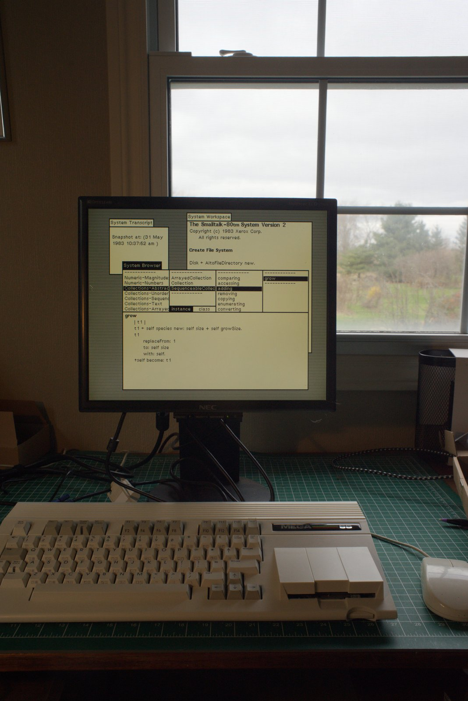
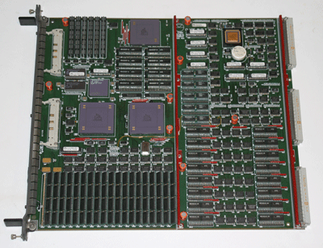
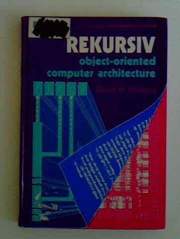
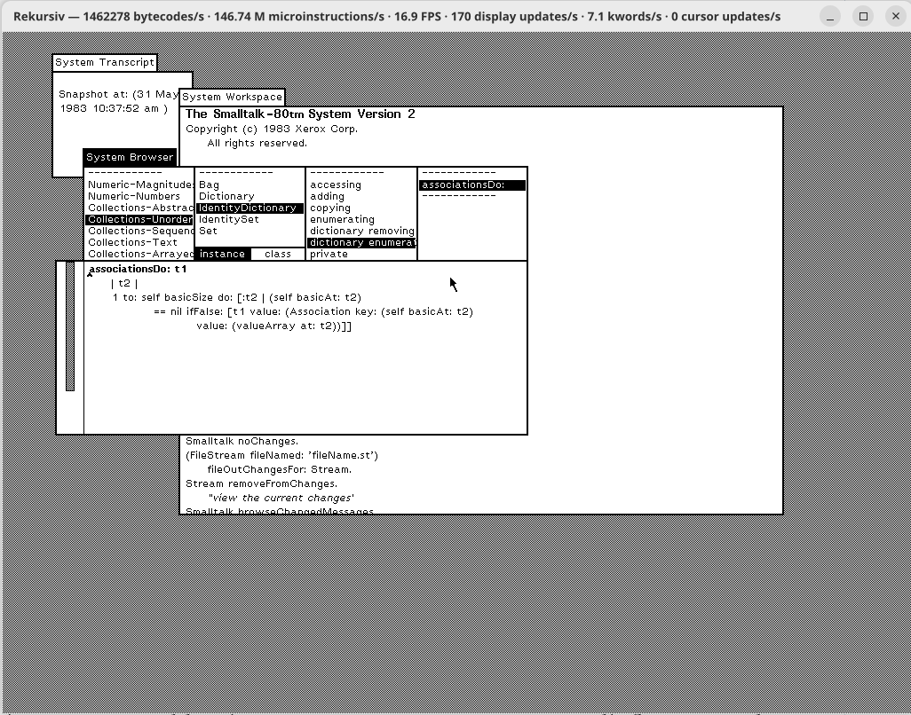

# Rekursiv

An attempt to build David Harland’s 1980s **Rekursiv** hardware object-oriented machine in
synthesizable SystemVerilog, with extensions.



_The Rekursiv running the 1983 Xerox Smalltalk-80 image on a MEGA65. See
[Booting on the MEGA65](#booting-on-the-mega65)._

[Rekursiv](https://en.wikipedia.org/wiki/Rekursiv) came from Linn Smart Computing, a division of the
Scottish hi-fi manufacturer Linn Products. Linn wanted better software to run its factory. Its
experiments with LINGO, a language related to Smalltalk, led to an unusual next step: building a
processor for object-oriented programs. Harland and his colleagues developed a custom chipset and
the HADES board, which plugged into a Sun workstation.



_Original hardware. Photo from the
[Jim Austin Computer Collection](https://www.computermuseum.org.uk/fixed_pages/rekursiv1.html)._

The idea was to put object management into the machine itself. Programs used stable object
identities, while hardware and microcode handled object lookup, checked field access, allocation,
paging, and garbage collection. Objects could move without changing references to them. The
architecture treated RAM and disk as a persistent object store, so objects could outlive the
programs that created them. Programmers could define language-specific instruction sets in
microcode, including recursive routines.

Only a small number of boards reached users before Linn shut the project down.
[James Lothian’s 1993 recollection](https://groups.google.com/g/comp.arch/c/Rb08QH5Jsl0/m/QuwXBHQgF5kJ)
describes the architecture, the commercial troubles, and life as a Rekursiv programmer. It also
recounts the infamous collision between a Linn van and Harland’s Porsche, and the dispute over
repairs that followed.

<a href="https://openlibrary.org/books/OL2044584M/REKURSIV"></a>

The starting point is Harland’s
[_Rekursiv: Object-Oriented Computer Architecture_](https://openlibrary.org/books/OL2044584M/REKURSIV)
(Ellis Horwood, 1988).

## The machine

The implementation follows the three main parts of the Rekursiv architecture:

- **OBJEKT** manages object identities, resident metadata, field access, allocation, and transfers
  between object memory and backing storage.
- **LOGIK** executes microcode and controls instruction dispatch, branches, calls, and stacks.
- **NUMERIK** provides integer and floating-point arithmetic, registers, and arithmetic flags.

This version uses a **40-bit object representation**, with tagged object references and compact
values. It defines its own control-word encodings and memory handshakes. Object memory is intended
to use external SRAM or DRAM.

Historical binary compatibility is not a goal. We have no original software images to target, and it
is unclear whether any usable copies survive. Perhaps there is a backup at the bottom of the
[Forth and Clyde canal](https://en.wikipedia.org/wiki/Rekursiv#History).

The first language implementation is **Smalltalk-80**, in place of the original machine’s LINGO.
Language-specific object layouts, method lookup, and bytecode execution live in microcode. The
lower-level hardware remains independent of Smalltalk.

The machine currently runs **Smalltalk-80** from a converted Xerox image, with a graphical desktop,
keyboard, and mouse. The "Blue Book" was used as a reference to write the microcode which ultimately
executes on the emulated Rekursiv hardware.

A separate microcode profile runs the **Squeak 1.1** colour desktop, with binary64 Floats and mouse
menus. Squeak is tested only in the native software emulator.



_Smalltalk-80 running on Rekursiv microcode in the native emulator._

## Booting on the MEGA65

The goal has been to run this Smalltalk-80 workstation on real hardware; I ended up using my
[MEGA65](https://mega65.org/), a modern Commodore 65 whose Artix-7 FPGA can be loaded with other
machines' cores. It now does, standalone: object memory in the board's SDRAM, the object image on
its SD card, the desktop on its HDMI or VGA output, its own keyboard, and an Atari ST mouse in a
joystick port.

The original Rekursiv was a board in a Sun workstation, and the Sun did its disk work. Here that
job falls to a small RISC-V processor (a PicoRV32) built into the core beside LOGIK, OBJEKT and
NUMERIK. Everything else is the Rekursiv itself. A boot goes like this:

1. **The core loads.** The MEGA65 configures its FPGA from the Rekursiv core in a flash slot. The
   screen shows a panel of hex words: the machine's status on the left, the disk processor's on the
   right. Those rows are the whole debugging interface.
2. **The memory is checked.** Before OBJEKT may touch it, the SDRAM controller writes and reads back
   a pattern and its complement at every single-address-bit address, which finds stuck or shorted
   address and data lines in a few hundred cycles.
3. **The loader finds the firmware.** A first-stage loader in the disk processor's block RAM reads
   the FAT32 card, loads `REKURSIV.FW`, checks its CRC, and jumps to it.
4. **The firmware opens the object store.** `REKURSIV.IMG` is a file of 32 MB holding the 18,391
   objects of the Xerox image, converted to Rekursiv objects: a log of records with a journaled
   index, so a power cut never leaves it half-written.
5. **The machine is programmed.** The firmware streams `REKURSIV.BOO` into the halted machine:
   37,067 records of microcode for the interpreter and collector, roots, and service requests. Then
   it starts LOGIK and settles down to serve OBJEKT's requests for objects.
6. **Smalltalk starts with an empty memory.** Nothing is preloaded. The first bytecode needs its
   method, its context and its receiver, and OBJEKT faults each one in from the card by identity,
   on demand, through the disk processor. Objects land in SDRAM behind a block-RAM cache; when the
   32,768-entry pager fills, new objects are written back to the store and evicted, and the RAM
   collector, in microcode, reclaims the garbage.
7. **The desktop draws itself.** The image's own BitBlt, executed in microcode, paints the
   640×480 one-bit Display bitmap, and the core scans it out. The System Transcript reports
   _Snapshot at: (31 May 1983)_: the image was saved at Xerox forty-three years ago, and is running
   again on hardware its authors never imagined.

Keystrokes come from the MEGA65's keyboard controller as 128-bit serial frames, and mouse motion
from the quadrature lines of the joystick port. The machine runs at 25.2 MHz, which makes typing
usable but not yet brisk; [docs/performance-plan.md](docs/performance-plan.md) records where the
time goes and what comes next.

For a period yardstick, Allen Wirfs-Brock's 1983 talk
[_A High Performance Smalltalk-80 Interpreter_](https://www.wirfs-brock.com/allen/files/tek/Tek-Smalltalk-history-slides.pdf)
(Tektronix Computer Research Lab) charts the implementations of the day in bytecodes per second: the
Xerox Dorado at 300,000, Peter Deutsch's 68000 at 100,000, Tektronix's 68000 at 60,000, and the Xerox
Dolphin and Berkeley's VAX-11/780 at 35,000. Early ports, the talk says, "ranged between abysmal and
poor". The cycle estimator puts the Rekursiv on the MEGA65 at roughly 100,000 to 200,000 bytecodes per
second while handling a keystroke, depending on how often SDRAM reads miss the cache. The talk's own
recipe (a message lookup cache, cheap leaf contexts, context state cached in machine registers, no
reference counting) reads like a list of what this machine's microcode does.

## Implementation

The processor executes standalone microcode programs with integer arithmetic, stacks, object
allocation, checked access, writeback, and automatic refill. RAM garbage collection runs in LOGIK
microcode with OBJEKT hardware support. It traces objects, copies their bodies between two memory
regions, restores the interrupted program, and retries the allocation or refill.

The repository includes a text microassembler, a native Rust emulator with display, keyboard, and
mouse, and a Verilator simulator. A Rust architectural model checks the hardware's results. The
simulation harness supplies external memory and backing storage. The allocation and collection
examples execute their program control flow and garbage collection on the RTL processor.

The Smalltalk microcode executes bytecodes, runtime primitives, and process scheduling. NUMERIK
supports integer, binary32 and binary64 arithmetic. BitBlt runs in microcode and refreshes the
display as the original Smalltalk image draws its desktop. Snapshot saving remains unfinished. On
the MEGA65 the machine runs at 25.2 MHz with its object memory in
SDRAM, a 32,768-entry pager in block RAM, and its object store in a file on the SD card;
`board/mega65/smalltalk.sh` builds the card's files from the Xerox image.

## Build and run

Fetch the Xerox Smalltalk-80 image and run it in the native emulator:

```sh
python3 scripts/fetch-smalltalk-image.py
cargo run --release --locked -p rekursiv-emulator -- \
  --smalltalk artifacts/st80/VirtualImage --memory-words 16777216
```

To run the archived Squeak 1.1 image:

```sh
python3 scripts/fetch-squeak-image.py
cargo run --release --locked -p rekursiv-emulator -- \
  --squeak artifacts/squeak-1.1/Squeak1.1.image
```

Middle-click the background for the system menu. The [Squeak guide](docs/squeak-1.1.md) covers
supported primitives and remaining work. File writes remain in memory; snapshots cannot yet be
saved.

For the standalone display and input demo:

```sh
cargo run --release --locked -p rekursiv-emulator
```

Move the mouse or press a key to exercise the peripheral microcode. Close the window to exit. The
[emulator guide](docs/emulator.md) covers build dependencies, headless execution, traces, and the
Smalltalk image. This executable does not require Verilator or Yosys.

For RTL simulation and synthesis, install Rust with `rustfmt` and `clippy`, Verilator, Yosys, a C++
compiler, and Make. On Debian or Ubuntu, install the hardware tools with:

```sh
sudo apt-get install verilator yosys clang build-essential
```

Run a microcode program that allocates objects and triggers garbage collection:

```sh
cargo run --locked -p rekursiv-sim -- --microcode microcode/collection.uc
```

Run the allocation, eviction, and refill example with a listing and waveform:

```sh
cargo run --locked -p rekursiv-sim -- \
  --microcode microcode/allocation.uc --listing --trace-file allocation.vcd
```

Open the VCD file in a waveform viewer such as GTKWave. The [assembler guide](docs/assembler.md)
describes the source syntax, labels, control fields, and image directives. The programs in
[microcode/](microcode/) include both examples and the RAM collector. The
[microcode program guide](microcode/README.md) maps every runtime module and documents calling
conventions, object layouts, roots, and execution paths.

Run all examples, including the individual object-memory demonstrations:

```sh
cargo run --locked -p rekursiv-sim -- --example all
```

Use `--list` for example names and `--help` for simulator options, including memory delays and
response stalls. The simulator reports an error if the hardware disagrees with the reference model
or an example assertion fails.

## Development

Hardware lives in [rtl/](rtl/). The Rust workspace contains the [assembler](crates/rekursiv-asm/),
[architectural model](crates/rekursiv-model/), [native emulator](crates/rekursiv-emulator/),
[shared peripherals](crates/rekursiv-devices/), and [RTL simulator](crates/rekursiv-sim/). The
[interface reference](docs/interface.md) documents object commands, encodings, and memory
handshakes.

Run formatting checks, Clippy, tests, RTL lint, synthesis, and the examples with:

```sh
scripts/check.sh
```
